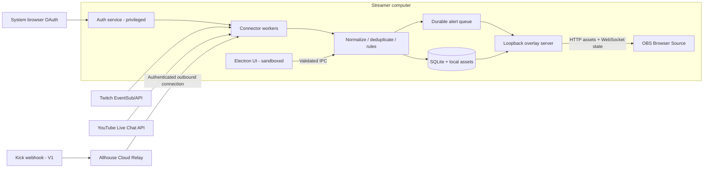

# Allhouse — System Architecture & Design

สถานะ: Proposed architecture; เอกสารออกแบบเท่านั้น ไม่มีการสร้าง application code  
ฉบับ: 0.3 • วันที่: 20 ตุลาคม 2026  
คู่เอกสาร: [FEATURES.md](FEATURES.md) · [APPDOC.md](APPDOC.md)

## 1. Executive decision

เลือก **Electron + React + TypeScript** เป็นฐานสำหรับ desktop app ที่เน้น overlay authoring และ OBS integration ใช้ **local-first architecture**: settings, assets, event processing และ overlay rendering อยู่ในเครื่อง เสริมบริการกลางสำหรับ public webhook, confidential OAuth client และ managed Chat TTS ใน V1 เพื่อไม่ให้ผู้ใช้ต้องจัดการ API key

เหตุผล: editor และ OBS Browser Source ใช้ web rendering concepts ร่วมกันได้ ลดการทำ layout engine ซ้ำ และเหมาะกับทีม TypeScript ข้อแลกเปลี่ยนคือ memory footprint และภาระอัปเดต Chromium/Electron จึงต้องตั้ง performance budget และจำกัด process/media

สมมติฐานที่เสนอ:

| เรื่อง | ข้อเสนอเริ่มต้น |
|---|---|
| OS แรก | Windows 11 x64; Windows ARM64, macOS และ Linux ต้องผ่าน packaging/QA แยกก่อนประกาศรองรับ |
| OBS | OBS Studio รุ่น stable ที่ตรวจรับรองก่อนปล่อย + stable ก่อนหน้า 1 รุ่น; จด exact versions ใน release matrix |
| ตำแหน่ง OBS | เครื่องเดียวกับ Allhouse ใน MVP |
| Account | ไม่บังคับ Allhouse account สำหรับ local editor/test; platform login จำเป็นเมื่อรับข้อมูลจริง |
| Channels | หนึ่ง account/channel ต่อ platform ใน MVP; หลาย platform พร้อมกัน |
| ขนาดหน้าต่าง | ขั้นต่ำที่เสนอ 800×600 logical px; เป้าหมายใช้งานเต็ม 1280×720 ขึ้นไป |
| การเผยแพร่ | Signed installer; stable/beta channels; ไม่อัปเดตอัตโนมัติระหว่าง active session |
| Business model | ยังไม่ตัดสินใจ; ไม่ใส่ subscription/paywall เป็น baseline |

## 2. System context

Video/audio broadcast จาก OBS ไปแพลตฟอร์มเป็นอีกเส้นทางหนึ่งและไม่ผ่าน Allhouse

## 3. Technology stack ที่เสนอ

ไม่ล็อกหมายเลขเวอร์ชันจากการคาดเดา ให้เลือก stable supported releases และ pin exact versions/lockfile เมื่อเริ่ม implementation

| ส่วน | เครื่องมือ | เหตุผล / ข้อควรตรวจ |
|---|---|---|
| Desktop shell | Electron | tray, lifecycle, native integration; แยก UI ออกจาก privileged services |
| UI | React + TypeScript | typed component model และ reuse widget renderer |
| Build | Vite + Electron Forge | build/package pipeline; spike native SQLite packaging และ installer/update channel ก่อน |
| UI primitives | Radix UI + Tailwind CSS | keyboard-friendly primitives + design tokens; ต้องทดสอบ accessibility จริง |
| Icons | Lucide | stroke style สม่ำเสมอ; ตรวจ license และ bundle เฉพาะที่ใช้ |
| Client state | Zustand | editor/session state; credentials ห้ามอยู่ใน store นี้ |
| Forms/validation | React Hook Form + Zod | validation ทั้ง UI และ privileged boundary; UI validation อย่างเดียวไม่พอ |
| Layout editor | DOM/CSS transforms + pointer interactions | แสดงผลใกล้เคียง OBS; แยก scene model ออกจาก selection handles |
| Animation | CSS/Web Animations API | predictable duration; bounded effects; reduced motion |
| Local server | Fastify + WebSocket implementation | schema validation และ local asset/state routes |
| Database | SQLite + typed migrations | transactional queue/config/history; WAL; driver ทำงานใน worker และต้อง compatible กับ Electron |
| Secrets | Electron safeStorage + OS-protected key storage | ตรวจ encryption availability; ห้าม silent fallback เป็น plaintext |
| Localization | i18next | TH/EN keys, plurals, dates/numbers; translation ไม่ hardcode ใน widget |
| Chat TTS — V1 | TTS adapter; Azure AI Speech เป็น cloud candidate หลัก | มี voice ไทย/อังกฤษ; synthesize เป็น audio ส่งเข้า OBS; ต้องตรวจ region, quota และต้นทุนก่อนเปิดจริง |
| Fonts | Noto Sans Thai + Noto Sans | รองรับไทย/อังกฤษเป็น family ที่เข้ากัน; bundle offline พร้อม license |
| Unit/integration | Vitest | normalization, rules, queue, migrations, protocol |
| UI testing | Playwright | desktop workflows ตาม Electron support ที่ยืนยัน; OBS ต้องมี dedicated smoke suite |
| Relay — V1 | TypeScript service + PostgreSQL | tenant isolation, webhook inbox, durable delivery; เริ่มด้วย service เดียว |
| Operations | Structured logs + OpenTelemetry-compatible metrics | correlation IDs และ opt-in desktop diagnostics; redact sensitive data |

ยังไม่เพิ่ม Redis, Kubernetes, microservices หรือ event streaming cluster จนกว่าภาระงานที่วัดได้ต้องการ

## 4. Process boundaries และ repository layout ที่เสนอ

นี่เป็นโครงสร้างสำหรับอนาคต ยังไม่ได้สร้างโฟลเดอร์หรือโค้ด

| Module | หน้าที่ | ข้อห้าม |
|---|---|---|
| desktop/main | lifecycle, permissioned IPC, auth orchestration, secret access | ไม่ render ข้อความ chat เป็น HTML |
| desktop/preload | expose API แบบจำกัดด้วย contextBridge | ไม่ expose filesystem, shell หรือ raw ipcRenderer |
| desktop/renderer | dashboard, editor, settings | ไม่มี Node integration หรือ provider tokens |
| local-runtime worker | connectors, rules, queue, storage, loopback server | ไม่ block main thread; ไม่มี third-party executable plugins |
| packages/domain | event types, capability schema, rules | ไม่ผูก Electron/OBS เพื่อทดสอบได้ |
| packages/overlay-renderer | widgets และ animation runtime | ไม่รับ arbitrary script; ไม่เข้าถึง credentials |
| packages/protocol | versioned IPC/overlay/relay contracts | reject unsupported versions |
| services/relay — V1 | verify webhook, tenant routing, bounded delivery | ไม่รับ media stream หรือเก็บ secrets ใน client bundle |

Renderer crash ต้องไม่หยุด runtime; runtime crash ต้องให้ supervisor restart แบบมีขีดจำกัดและเข้า safe mode หากล้มซ้ำ การปิดหน้าต่างแบบ run-in-tray ต้องไม่ปิด runtime แต่คำสั่ง Quit ปิดจริงและทำให้ overlay offline

## 5. Authentication และ platform adapters

### OAuth policy

- Product flow: Connect → system-browser login/account selection → provider consent → return to connected state; MFA/consent/account selection ที่ provider กำหนดต้องแสดงตามจริง
- Allhouse เป็นเจ้าของ developer applications, verification/review, callback domains และ credentials; ไม่ให้ end user สร้าง developer project หรือใส่ client ID/secret
- ตรวจ channel/live อัตโนมัติเมื่อมีตัวเลือกเดียว; ถ้ามีหลายรายการใช้ picker ชื่อ/ภาพ; ไม่เลือกบัญชีที่กำกวมเงียบ ๆ
- แสดง “Connected — waiting for live” เมื่อเชื่อมแล้วแต่ยังไม่ live; discovery ใช้ bounded polling/backoff เคารพ quota; มี manual refresh โดยไม่ต้อง login ซ้ำ
- งาน developer registration และ provider approval เป็น release dependency ของทีม Allhouse รวมถึงกรณีเจ้าของผลิตภัณฑ์เป็น streamer คนเดียว ไม่ใช่ขั้นตอนที่สามารถตัดทิ้งได้ด้วย UI

- เปิด consent ใน system browser; ตรวจ state และ callback binding; PKCE เฉพาะ flow/provider ที่รองรับและตามข้อกำหนดของ provider
- Google desktop ใช้ native app OAuth และ loopback redirect ตามเอกสาร official
- Twitch/Kick ต้องทำ spike flow ที่ provider รองรับจริง หากต้องใช้ client secret ให้ token exchange อยู่ backend broker ไม่ฝัง secret ใน installer
- Consent ขอสิทธิ์ขั้นต่ำตาม capability; action เช่น moderation ใช้ reauthorization ตาม flow ที่ provider รองรับเมื่อผู้ใช้เปิดฟีเจอร์ ไม่สมมติว่าทุก native flow รองรับ incremental authorization
- Refresh tokens เก็บ encrypted; refresh แบบ single-flight ต่อ account; invalid_grant เปลี่ยนเป็น reconnect required
- Disconnect ยกเลิก subscriptions/revoke ตาม provider support, ลบ local secret และ relay binding; รายงานถ้า provider revoke ไม่สำเร็จ
- Broker handoff ใช้ one-time code อายุสั้นผูก state/device session; ไม่ส่ง provider token ใน URL

### Adapter contract

แต่ละ adapter ต้องมี capability discovery, connect/disconnect, refresh, subscribe/unsubscribe, health, normalize และ recovery cursor ถ้า provider มีให้

สถานะมาตรฐาน: disconnected → authorizing → connecting → connected → degraded/reconnecting → expired/error; capability ที่ยังไม่มีสิทธิ์ใช้ unavailable พร้อม reason

Event capability ไม่เหมารวมเป็น boolean “platform supported” เช่น YouTube chat ใช้ได้ไม่ได้หมายความว่าทำ subscriber alert ได้ครบทุกคน

### YouTube และ Twitch recovery

- Twitch แยก provider-directed reconnect กับการขาดการเชื่อมต่อจริง; reconnect/resubscribe ตาม official protocol; อย่าสมัครซ้ำทุกครั้งโดยไม่มี state
- YouTube เลือก broadcast/liveChatId ชัดเจน; streamList ใช้ continuation token ตามข้อกำหนด; fallback list เคารพ polling interval/quota
- Initial history/backfill บันทึกเป็น historical และไม่เล่น alerts เป็นค่าเริ่มต้น; live ended ไม่ retry แบบไม่มีวันจบ

### Kick relay — V1

1. Provider ส่งไป public HTTPS endpoint
2. ตรวจ signature จาก raw body, timestamp freshness และ unique message ID
3. ตรวจ subscription/channel → tenant/device mapping ฝั่ง server ห้ามเชื่อ tenant ID จาก payload ที่ client ส่ง
4. บันทึก inbox transaction ก่อนตอบสำเร็จ; duplicate ตอบรับได้โดยไม่ enqueue ซ้ำ
5. Desktop สร้าง outbound authenticated connection; relay ส่ง event พร้อม delivery ID
6. Desktop ack หลังบันทึก event แบบ durable; relay retry เมื่อยังไม่ ack ตาม bounded retention

Desktop offline: relay เก็บ pending สูงสุด 24 ชั่วโมงเป็นค่าเริ่มต้นที่เสนอ; เมื่อกลับมาแสดงย้อนหลังใน history แต่เล่นเฉพาะ events สดตาม TTL ห้ามเทย้อนหลังเป็นเสียงชุดใหญ่ เกิน retention ให้แสดง gap ไม่อ้างว่ารับข้อมูลครบ

Relay metrics: verification failures, delivery lag, queue depth, disconnects และ per-tenant limits; มี dead-letter inspection ที่จำกัดสิทธิ์และไม่ใช้ chat text ใน metric labels

## 6. Event model และ semantics

Canonical event fields:

| Field | ความหมาย |
|---|---|
| id / schemaVersion | internal ID และ version ของ normalized payload |
| platform / accountId / channelId | routing ที่ผูกกับบัญชีจริง |
| providerEventId / deliveryId | event identity กับ transport identity; บาง provider อาจมีไม่ครบ |
| type / originalType | canonical type และ provider type ที่ไม่สูญรายละเอียด |
| occurredAt / receivedAt | UTC timestamps แยกเวลาต้นทางกับเวลาเข้าเครื่อง |
| actor | provider user ID, display name, optional avatar; nullable |
| message | plain text + validated structured emote references |
| value | decimal string หรือ integer minor units, currency/unit; ห้าม float สำหรับ monetary aggregation |
| metadata | เช่น tier, gift count, membership milestone; versioned allowlist |
| sourceMode | live, historical, test หรือ manual replay |
| correlationId | trace โดยไม่ใส่ secrets หรือชื่อผู้ชม |

Canonical types เริ่มต้น: chat.message, chat.deleted, user.followed, subscription.started, subscription.gifted, membership.milestone, support.received, raid.received และ stream.status ตาม capability ที่มีจริง

- subscription, membership, gifts และ cheer เก็บ semantics เดิม ไม่สมมติ conversion เป็นเงิน
- Unique dedup key ใช้ provider + channel + stable event ID; ถ้ามีแค่ delivery ID ต้องระบุข้อจำกัด
- Hash fallback ใช้ window สั้นและเก็บความมั่นใจ; ไม่อ้าง exactly-once เมื่อ provider ไม่มี stable identity
- Transport เป็น at-least-once; เป้าหมายคือ effectively-once logical alert ภายใน dedup window เริ่มต้น 24 ชั่วโมง
- Ordering รับประกันภายใน local queue ตาม accepted sequence; ไม่รับประกันลำดับเวลาข้าม platform
- Gift batch และ individual gift notifications ต้องมี provider-specific aggregation เพื่อไม่เล่นซ้ำหนึ่งธุรกรรม

### Alert lifecycle

received → normalized → matched → queued → dispatched → started → completed

ทางเลือกปลายทาง: suppressed, expired, skipped, failed และ interrupted ทุกสถานะมีเหตุผลและ timestamps

- บันทึก normalized event + queue item ใน transaction เดียวก่อน dispatch
- Rule priority มากกว่าชนะ; tie ใช้ user order แล้ว rule ID; MVP หนึ่ง event เลือกหนึ่ง rule ต่อ alert channel
- Renderer ส่ง started/completed พร้อม playback ID; timeout แล้ว mark failed/interrupted ตามสถานะ
- Reload/crash ระหว่างเล่นไม่รับประกันว่าเสียงไม่เคยดัง ให้ mark interrupted และไม่ replay อัตโนมัติ ผู้ใช้ replay เองได้
- Default duration 6 วินาที, cooldown 2 วินาที, freshness TTL 120 วินาที; ปรับได้ภายใต้เพดาน
- Queue capacity เริ่มต้น 200 items; แยก chat stream ออกจาก alert queue; overflow suppress ตาม priority และบันทึกจำนวนที่ถูกตัด
- Pause เกิน TTL จะทำให้ pending หมดอายุ; resume แสดงจำนวนหมดอายุและไม่ระเบิด alerts พร้อมกัน
- หนึ่ง authoritative playback owner ต่อ overlay โดย lease; preview ไม่มีสิทธิ์เล่น production audio; OBS หลาย sources ต้องไม่ทำให้เสียงซ้ำ
- หากต้องแสดง overlay เดียวหลายจอ รองรับ visual mirrors แยกจาก audio owner; MVP wizard เตือนเมื่อพบ renderer ซ้ำ

### Chat TTS pipeline — F29 / V1

เส้นทาง: normalized live chat → eligibility/moderation → language segmentation → durable TTS job → synthesis worker → audio scheduler → dedicated OBS audio Browser Source

ใช้ event เดียวกับ unified chat แต่ไม่ผ่าน alert rules จึงอ่านได้ทุกข้อความที่รับเข้าและผ่าน policy เมื่อเปิดโหมด Read every incoming chat; provider capability ยังเป็นข้อจำกัดเดิม

**Engine และภาษา**

- ออกแบบ TtsProvider interface สำหรับ listVoices, synthesize, cancel, health และ usage; เก็บ provider/voice/locale/settings version ใน job เพื่อไม่เปลี่ยนเสียงกลางคิว
- ตัวเลือก cloud ที่เสนอคือ Azure AI Speech: เอกสารระบุเสียงไทย `th-TH-PremwadeeNeural` และ `th-TH-NiwatNeural` และรองรับเสียงอังกฤษ; list voices จาก region/account จริงก่อนให้เลือก ไม่ hardcode ว่าทุกเสียงพร้อมเสมอ
- Baseline V1 เปลี่ยนเป็น **Allhouse-managed TTS**: desktop ส่งข้อความที่ผ่าน policy ไป Allhouse TTS gateway ผ่าน TLS; gateway เรียก Speech provider และส่ง audio กลับ; service key อยู่ server secret store เท่านั้น ไม่แจกไป desktop/renderer/OBS
- ผู้ใช้เปิด Chat TTS เลือกเสียงและทดสอบได้โดยไม่ต้องสมัคร Azure/ใส่ API key; BYOK ไม่อยู่ใน onboarding ปกติและยังไม่ใช่ baseline
- Gateway ต้องใช้ authenticated device session + entitlement ที่ตรวจฝั่ง server ไม่เชื่อ device ID/account ID จาก request; มี rate/character/concurrency limits, cancellation, usage ledger, tenant isolation และ service-wide cost circuit breaker
- Local editor/test ไม่บังคับ Allhouse account เช่นเดิม; managed cloud session เชื่อมกับ platform identity ที่ backend ตรวจยืนยันผ่าน flow ที่รองรับ ไม่รับชื่อช่องเป็นหลักฐาน หากจำเป็นต้องมี Allhouse sign-in ให้ reuse identity ที่ยืนยันแล้วโดยแจ้งการสร้าง/ผูกบัญชี ไม่บังคับตั้งรหัสผ่านใหม่ และไม่ผูกหลายบัญชีด้วย email/name ที่คาดเดา
- การกำหนด free quota/paid plan ยังเปิดอยู่และต้องตัดสินใจก่อนเปิด public TTS; UX แสดง allowance ที่เหลือและขอสมัครบริการก่อนเกิดค่าใช้จ่าย ไม่รับปากว่าใช้งาน cloud ได้ฟรีไม่จำกัด
- Thai/English forced mode และ Auto mode; Auto ตรวจ script/ภาษาเป็นช่วงข้อความแล้วใช้ voice ตาม locale; punctuation/ตัวเลขที่กำกวมใช้ภาษาข้างเคียงหรือ workspace fallback
- ประกอบช่วงเสียงของหนึ่งข้อความให้เสร็จก่อน playback เพื่อรักษาลำดับ; จำกัดจำนวน segments; multilingual voice ใช้แทนได้เฉพาะเมื่อยืนยันรองรับ TH/EN จริง
- ไม่รับ SSML จาก chat โดยตรง; escape text และสร้าง markup จาก allowlist ของระบบ; ไม่อ่านข้อความเป็นคำสั่งให้เครื่องมือหรือ AI
- OS/local TTS เป็น optional adapter หลังพิสูจน์ voice และ audio capture ได้บนเครื่องเป้าหมาย ไม่ถือว่า Windows/Electron มีเสียงไทยครบโดยอัตโนมัติ

**Queue และเสียง**

- หนึ่ง TTS queue ต่อ active workspace; job key ผูก normalized event ID; accepted sequence เป็นลำดับอ่าน แม้ synthesis เสร็จไม่พร้อมกัน
- States: queued → synthesizing → ready → playing → completed; ทางออก skipped/expired/cancelled/failed/interrupted พร้อม reason
- ค่าเริ่มต้นที่เสนอ: 300 grapheme clusters ต่อข้อความ, สูงสุด 30 วินาทีเสียง, 100 pending jobs, freshness TTL 120 วินาที; ตัดข้อความเกินเพดานพร้อมสถานะ truncated
- Queue เต็มให้ skip incoming job พร้อม overflow counter; ไม่มี silent drop; synthesis timeout 15 วินาทีและ retry ไม่เกินหนึ่งครั้งเมื่อเป็น transient error/ยังไม่หมด TTL โดยเคารพ Retry-After
- Prefetch สูงสุด 2 jobs; จำกัดจำนวนอักขระส่ง provider ต่อ session ตาม user budget; budget cap เป็นข้อจำกัด usage ที่แอพ ไม่ใช่คำรับรองยอดบิล provider
- TTS และ alert voice ใช้ workspace audio scheduler ร่วมกัน: รอข้อความปัจจุบันจบก่อน alert ที่มีเสียง แล้วเล่น TTS ต่อ; ไม่ให้สองเสียงพูดทับกัน; alert แบบภาพอย่างเดียวเริ่มได้ทันที
- Output ใช้ **Allhouse — Chat TTS** Browser Source แยกที่ไม่มีภาพและส่ง audio อย่างเดียว; scoped read token และ single playback lease ตาม local protocol; reuse source เดียวในหลาย scenes
- Audio file/blob ต้องได้รับ scoped authorization และหมดอายุ; ลบ temporary audio หลังเล่น/ยกเลิก/หมด TTL พร้อม cleanup ตอน startup; ไม่เก็บใน backup/history
- Preview เป็น local audition แยกจาก production; monitoring ผ่าน OBS เป็นตัวเลือกของผู้ใช้เพื่อป้องกันเสียงสองทาง
- TTS off/Stop all หยุดเสียงและยกเลิก queue; Mute TTS ปิดเสียงและ suppress pending/new speech จน unmute ไม่สะสมเสียงย้อนหลัง; Pause คง queue ตาม TTL
- Source disconnect/crash ทำให้ playing job เป็น interrupted และไม่ replay อัตโนมัติ; pending รอ renderer ภายใน TTL; moderation cancel ทำได้ตั้งแต่ก่อน synthesize ถึงขณะ playback

**Privacy และ release checks**

- Cloud mode ส่งข้อความที่จะอ่านผ่าน Allhouse gateway ไป Speech provider และชื่อผู้ส่งเฉพาะเมื่อเปิด Read sender name; ไม่ส่ง platform tokens หรือ raw event payload ไป Speech provider; gateway ไม่เก็บ text/audio ถาวร และลบ temporary data หลังงานจบ/timeout โดยกำหนดเพดาน cleanup 1 ชั่วโมง
- หน้าเปิดใช้แจ้ง cloud provider, region, data handling link และค่าใช้บริการ; ไม่มีการเปลี่ยน provider อัตโนมัติ; ไม่ใส่ chat text ใน synthesis logs
- วัด chat accepted → audio start แยก synthesis latency/queue wait; เป้าหมาย p95 ≤3 วินาทีเมื่อคิวว่างและ provider ทำงานปกติ ต้องยืนยันด้วย benchmark; ไม่ใช้ budget 500 ms ของ local alerts
- ทดสอบ TH/EN/mixed-language แบบฟังจริง, bot filters, deleted messages, duplicate events, source ซ้ำ, crash/restart, quota exhaustion และ cloud outage
- Release F29 ต้องผ่านข้อความไทยและอังกฤษจริงอย่างน้อยหนึ่ง voice ต่อภาษา; offline fallback จะประกาศรองรับได้ต่อเมื่อทดสอบแล้ว

## 7. Storage และ data lifecycle

เก็บใต้ OS application-data directory ไม่เขียนทับโปรเจกต์ต้นฉบับ: บน Windows ใช้ตำแหน่งจาก Electron app.getPath('userData')

| Entity | ข้อมูลหลัก |
|---|---|
| Workspace | name, locale, active profile, schema version |
| PlatformConnection | platform/channel/capabilities/status + secret reference |
| Overlay | workspace, canvas, published revision, renderer token reference |
| Widget / Asset | layout properties, bindings, file hash, MIME, size |
| AlertRule | filters, priority, template reference, cooldown |
| Event / AlertJob | normalized payload, dedup key, state, playback IDs |
| TtsSettings / TtsJob — V1 | enabled platforms, voices, language mode, filters, budget, event reference และ playback state; secret เป็น reference เท่านั้น |
| Session / Diagnostic | start/end, aggregate counters, redacted error codes |

- SQLite WAL, migrations แบบ versioned; backup ก่อน migration; failure ต้องกลับมาเปิดฐานเดิมได้
- Assets จัดเก็บด้วย content hash; จำกัด path และตรวจ MIME จริง; export manifest ใช้ relative paths
- ค่าเริ่มต้น: events/chat 7 วัน, diagnostic logs 14 วัน, relay pending ≤24 ชั่วโมง; user purge ได้; aggregates ที่เก็บต้องระบุแยก
- Backups ไม่รวม OAuth tokens, OBS password, relay credentials หรือ overlay access tokens; import สร้าง tokens ใหม่
- Import มี schema/size/file-count limits, zip-slip/zip-bomb defense และไม่ overwrite workspace เดิม
- “Disconnect” ไม่เท่ากับ “ลบประวัติ”; UI ให้เลือก purge ที่ชัดเจน
- MVP ไม่อัปโหลด assets/chat history ไป cloud อัตโนมัติ; relay เห็นเฉพาะข้อมูลที่จำเป็นต่อ integration

## 8. OBS integration protocol

Browser Source คือเส้นทางหลัก OBS WebSocket เป็นตัวช่วยใน V1 และไม่จำเป็นต่อการ render

- Local HTTP server bind **127.0.0.1 เท่านั้น**; ใช้ persisted available port พร้อม collision detection
- URL รูปแบบเชิงแนวคิด: `http://127.0.0.1:<port>/overlay/<id>#<read-only-token>`; token ใน fragment ไม่เข้า HTTP access log
- Shell ไม่คืน workspace data จน handshake ด้วย token ผ่าน WebSocket; แยก overlay-read token จาก privileged commands
- ตรวจ Host/Origin, จำกัด CORS และป้องกัน DNS rebinding; handshake รองรับ origin ของ OBS ที่ทดสอบแล้วเท่านั้น
- Asset routes ต้องใช้ scoped short-lived authorization; no directory listing/path traversal; ไม่ใช้ provider token เป็น asset URL
- เก็บ port/token คงที่หลัง restart; ถ้า port ชนห้ามเปลี่ยนเงียบ ให้ wizard ออก URL ใหม่และแจ้งแก้ใน OBS
- ปุ่ม regenerate URL revoke token เดิมทันทีและแจ้งให้ update OBS
- Client handshake ระบุ protocolVersion, overlayId, rendererInstanceId, revision และ last sequence; server ส่ง snapshot ก่อน deltas
- Lost deltas ใช้ sequence gap → resync snapshot; reconnect ไม่ replay finished alerts
- Heartbeat ใช้แสดง “renderer connected” เท่านั้น ไม่อนุมานว่า scene อยู่บน program output
- Transparent canvas, font/asset preload, bounded media decode; fallback เมื่อ media เสียต้องจบ queue item ได้
- เสียง alert ถูกส่งผ่าน OBS Browser Source; editor preview แยก output และมี mute; ไม่เปิด monitoring ซ้ำเป็นค่าเริ่มต้น
- Publish ใช้ revision ที่ commit ครบแล้ว; draft edits ไม่เปลี่ยน live overlay จนกด Publish

## 9. Visual design system

### Brand direction

ชื่อ **Allhouse** สื่อถึงพื้นที่รวมเครื่องมือสำหรับ streamer: modern studio, สงบ อ่านง่าย และมีสี accent ใช้เท่าที่จำเป็น ให้ content preview เป็นจุดเด่น ไม่ใช้ glass/blur หนักทั่วแอพ

### Color tokens — proposed

| Token | Light | Dark | หน้าที่ |
|---|---|---|---|
| background | #F7F8FC | #0B1020 | พื้นหลัก |
| surface | #FFFFFF | #151C2F | panel/card |
| surfaceRaised | #EEF1F8 | #1D2740 | hover/raised region |
| textPrimary | #172033 | #F3F6FC | ข้อความหลัก |
| textSecondary | #526079 | #ADB9D0 | คำอธิบาย |
| border | #D8DEEA | #33415E | ขอบ |
| accent | #5B42D6 | #B5A5FF | action/focus |
| onAccent | #FFFFFF | #17112E | ข้อความบน accent |
| success | #157347 | #65D9A0 | connected |
| warning | #8A5100 | #FFD08A | degraded |
| danger | #B42335 | #FF8C9C | error/destructive |

สีเป็น design proposal ต้องตรวจ contrast ทุก state กับพื้นหลังจริง โดยเฉพาะ disabled, badges และ overlay บนวิดีโอ ไม่ใช้สีอย่างเดียวบอกสถานะ

### Typography

- Font stack: Noto Sans Thai, Noto Sans, system-ui; bundle WOFF2/ชุด license ในแอพเพื่อทำงาน offline
- Body 14–16 px, labels 13–14 px, headings 20/24/32 px; line-height ไทย 1.5–1.7 ป้องกันวรรณยุกต์ถูกตัด
- Weight 400/500/600/700; ไม่ fake bold; ทดสอบ mixed TH/EN, emoji และตัวเลขสกุลเงิน
- เลขเวลา/จำนวนใช้ tabular numerals เมื่อ font รองรับ
- Text scaling อย่างน้อย 200% ต้องยังอ่าน/เข้าถึง controls ได้

### Layout และ responsive behavior

| ความกว้าง logical px | พฤติกรรม |
|---|---|
| ≥1440 | sidebar 232 px + main + inspector 320 px; editor สามคอลัมน์ |
| 1100–1439 | sidebar ย่อ 72 px; inspector toggle; preview ใช้พื้นที่หลัก |
| 800–1099 | navigation drawer; inspector เป็น sheet/tab; toolbar wrap |
| <800 | reflow แบบ single column สำหรับ preview/shared components; desktop window MVP ไม่รับรองต่ำกว่า minimum |

คำว่า responsive ไม่ได้แปลว่า native mobile app: shell ปรับตามพื้นที่ desktop; overlay canvas ยึด output resolution แล้ว scale-to-fit ใน editor ไม่เปลี่ยนพิกัดเมื่อย่อหน้าต่าง

ตรวจ Windows display scale 100/125/150/200%, 1366×768 ถึง 4K และ multi-monitor DPI change พื้นที่ editor pan/zoom ได้ แต่หน้าฟอร์มไม่บังคับ horizontal scroll

### Interaction standards

- Spacing 4/8/12/16/24/32, card radius 12, control radius 8, control height 36–40 px
- Focus ring ชัดเจน, keyboard alternative สำหรับ drag/resize, label และ accessible name ครบ
- Contrast เป้าหมายข้อความปกติ ≥4.5:1, large text/UI boundary ตามเกณฑ์ที่เกี่ยวข้อง; ต้องวัดก่อน release
- Motion 120–200 ms สำหรับ UI; reduced motion ปิด nonessential movement
- Toast ใช้แจ้งผลสั้น; งานผิดพลาดสำคัญอยู่ inline และย้อนดูได้
- Empty/loading/offline/error/permission-denied states ต้องออกแบบทุกหน้าที่เกี่ยวข้อง

### Information architecture

1. **Dashboard:** connection health, active workspace, queue summary, preflight
2. **Connections:** accounts, permissions, platform capabilities
3. **Overlays:** projects, templates, editor, publish และ OBS URL
4. **Alerts:** appearance, rules, queue, tests; V1 เพิ่มแท็บ **Chat TTS** สำหรับ voices, source selection, speech queue และ OBS audio setup
5. **Activity:** unified events/chat, filters, history
6. **Assets:** import, preview, usage และ missing files
7. **OBS Setup:** guided Browser Source setup, renderer diagnostics
8. **Settings:** language/theme, privacy, backup, startup, updates, support

Global header แสดง workspace, session state และ mute/pause เสมอ; relay status แสดงเมื่อ workspace ใช้งาน service นี้

## 10. Security baseline

- Electron: contextIsolation=true, sandbox=true, nodeIntegration=false; packaged local UI; restrictive CSP
- Validate IPC sender, payload และ authorization; allowlist external links/navigation; ไม่ให้ chat เปิด shell หรือ local path
- Treat usernames, chat, emotes, filenames และ imported templates เป็น untrusted data; render plain text; ไม่ใช้ raw HTML
- ไม่มี custom scripts/remote executable code; URL media fetch จำกัด schemes, hosts, MIME, size และ redirects
- Local endpoint tokens มี entropy สูง, scopes จำกัด, revoke ได้; credentials ไม่อยู่ใน browser source/page data
- Logs/exports ตัด auth headers, URL tokens, message contents ที่ไม่จำเป็น และ secret-bearing paths
- หาก OS secure storage ใช้ไม่ได้ ให้รับ session-only login หรือหยุด persistence โดยแจ้งชัด ห้ามเขียน plaintext fallback
- Signed installer/update artifacts, TLS distribution, signature verification; เก็บ signing credentials นอก repo
- จำกัด file size เริ่มต้น image 20 MB, audio 25 MB, video 100 MB, workspace import 500 MB; ตรวจ codec/dimensions/duration เพิ่ม
- Update dependencies อย่างต่อเนื่อง; provider deprecation/capability removal ต้องปิดเฉพาะ adapter ได้อย่างปลอดภัย

## 11. Reliability, performance และ observability

ตัวเลขต่อไปนี้เป็นเป้าหมายต้องวัด ไม่ใช่คำรับรอง

เครื่อง reference: Windows 11, CPU 4 cores, RAM 16 GB, SSD, GPU hardware acceleration; ทดสอบร่วม OBS 1080p60 พร้อมระบุ hardware จริงในผล

| Metric | เป้าหมายเริ่มต้น |
|---|---|
| Cold start → dashboard usable | p95 ≤5 วินาทีบน reference machine |
| Idle Allhouse memory | ≤350 MB RSS รวม application child processes; ไม่รวม OBS |
| Typical active workspace memory | ≤650 MB ภายใต้ sample scene ที่นิยาม |
| Idle CPU | เฉลี่ย ≤2% รวมทุก core แบบ OS-reported ในช่วง 60 วินาที |
| Local event → render start | p95 ≤500 ms เมื่อ queue ว่าง |
| Overlay rendering | target 60 fps สำหรับ 1080p reference scene; p95 frame interval ≤20 ms |
| Load test | chat 100 messages/s นาน 5 นาที + alert burst 50 events/10 s; queue/memory bounded |
| Soak test | 8 ชั่วโมง; ไม่มี crash; retained memory หลัง warmup ไม่โตต่อเนื่อง |
| Reconnect | เริ่ม retry ใน 1 วินาทีแล้ว backoff+jitter สูงสุด 60 วินาที; เคารพ Retry-After |

Reference scene: 10 widgets, 1 chat widget จำกัด visible 50 messages, 1 alert animation และ 1 video asset ที่กำหนดขนาดไว้ ทุก benchmark บันทึก scene/OBS version

Metrics ที่แสดง: last event received, connector lag, queue depth, suppressed count, renderer heartbeat, frame health และ relay status แยกกัน ไม่มี viewer count รวมที่อ้างว่าเป็น unique people

## 12. Test strategy และ release readiness

| ประเภท | ตัวอย่างที่ต้องผ่าน |
|---|---|
| Domain | dedup, event mapping, money/unit preservation, gift aggregation, rule tie-break |
| Recovery | token expiry, network loss, revoked scope, quota exhaustion, provider reconnect |
| Queue | crash หลัง persist/ก่อน ack/ระหว่างเสียง, stale TTL, overflow, replay ไม่เพิ่ม counters |
| Rendering | TH marks, long names, emoji, transparent background, audio once, missing media, source hide/reload |
| Persistence | schema migration failure, corrupt import, backup/restore, port collision, asset missing |
| Security | XSS text, invalid IPC, unauthorized local WS, hostile Origin/Host, zip traversal, secrets redaction |
| Relay — V1 | bad signature, stale message, duplicates, tenant mismatch, offline retention, retry |
| End-to-end | ติดตั้งใหม่ → connect → template → test → publish → OBS → restart → restore |
| Accessibility | keyboard-only, screen reader labels, contrast, 200% scaling, reduced motion |
| Distribution | clean-machine install/uninstall, signed build, update rollback path, preserve user data |

ใช้ synthetic fixtures สำหรับ routine tests; live provider tests ใช้บัญชีทดสอบที่ได้รับอนุญาตและเคารพ quota การตรวจ OBS จริงจำเป็นเพราะ Electron preview ไม่ใช่หลักฐานว่า OBS browser engine เล่นได้เหมือนกัน

Release ต้องมี support matrix, known limitations, diagnostics guide, privacy notice, dependency licenses, update recovery และ capability evidence ครบ

## 13. ADR และประเด็นที่ยังเปิด

| Decision | สถานะ | เหตุผล / เงื่อนไขทบทวน |
|---|---|---|
| Electron แทน native shell | Proposed | สะดวกต่อ shared web rendering; ทบทวนหาก budget memory ไม่ผ่าน |
| Local-first + selective relay | Proposed | overlay ใช้งานในเครื่องได้; public webhooks ต้องการ backend |
| Browser Source เป็น primary | Proposed | user setup เข้าใจง่ายและแยกจาก OBS control API |
| Windows-first | Assumption | ต้องยืนยันตลาดเป้าหมายก่อนเพิ่ม OS QA |
| TikTok ไม่อยู่ MVP | Gate | ยังไม่มีหลักฐาน access ที่เพียงพอสำหรับรับประกัน LIVE events |
| Draft/publish separation | Proposed | ป้องกันแก้ layout กลาง live โดยไม่ตั้งใจ |
| No arbitrary template code | Proposed | ลด execution risk และปัญหา compatibility |

เรื่องที่ต้องตัดสินใจก่อนเริ่ม implementation:

- เจ้าของ developer accounts, app registration, scopes และ provider review requirements
- Managed TTS gateway, verified cloud identity, entitlement/free quota และงบ provider; เป็น V1 release gate ก่อนสัญญาว่าเปิด TTS แล้วใช้ได้ทันที
- Twitch/Kick OAuth flow ที่ใช้ได้จริง และจำเป็นต้องมี broker ใน MVP หรือไม่
- จำนวนผู้ใช้พร้อมกัน/ภูมิภาค, relay hosting budget, monitoring และผู้รับผิดชอบ incident
- แนวทาง distribution/signing, supported hardware และ OS เพิ่มเติม
- ความต้องการจริงเรื่อง restream, donation providers และ TikTok authorized access

## 14. Official references

ตรวจวันที่ 20 ตุลาคม 2026; ต้องตรวจอีกครั้งก่อน pin dependencies และขอ permissions

- [Electron security](https://www.electronjs.org/docs/latest/tutorial/security)
- [Electron safeStorage](https://www.electronjs.org/docs/latest/api/safe-storage)
- [Google OAuth for desktop apps](https://developers.google.com/identity/protocols/oauth2/native-app)
- [Twitch EventSub reference](https://dev.twitch.tv/docs/eventsub/eventsub-reference/)
- [Twitch WebSocket handling](https://dev.twitch.tv/docs/eventsub/handling-websocket-events)
- [YouTube streamList](https://developers.google.com/youtube/data/live/reference/rest/v3/liveChatMessages/streamList)
- [Kick events](https://github.com/KickEngineering/KickDevDocs/blob/main/events/introduction.md) และ [Webhook security](https://github.com/KickEngineering/KickDevDocs/blob/main/events/webhook-security.md)
- [TikTok documentation](https://developers.tiktok.com/doc/)
- [OBS Browser Source](https://obsproject.com/kb/browser-source) และ [Remote Control Guide](https://obsproject.com/kb/remote-control-guide)
- [Noto Sans Thai metadata/license location](https://github.com/google/fonts/tree/main/ofl/notosansthai)
- [Azure Speech language and voice support](https://learn.microsoft.com/en-us/azure/ai-services/speech-service/language-support?tabs=text-to-speech)
- [Azure speech synthesis and audio output](https://learn.microsoft.com/en-us/azure/ai-services/speech-service/how-to-speech-synthesis)
