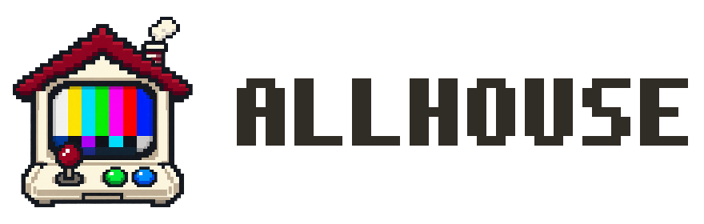

  <picture>
    <source media="(prefers-color-scheme: dark)" srcset="public/brand/allhouse-lockup-dark.png">
    
  </picture>

<b>แชท การแจ้งเตือน และวิดเจ็ต OBS จากทุกแพลตฟอร์ม รวมไว้ในบ้านหลังเดียว</b> 
Chat, alerts and OBS widgets from every platform, together in one house.

  

  <a href="https://github.com/IZoom7/allhouse-multistream/releases/tag/v0.1.0">รายละเอียดรุ่นนี้ · Release notes</a>
  &nbsp;·&nbsp;
  <a href="https://github.com/IZoom7/allhouse-multistream/releases/download/v0.1.0/Allhouse-Setup-0.1.0.exe.sha256">SHA-256</a>
  &nbsp;·&nbsp;
  <a href="https://github.com/IZoom7/allhouse-multistream/releases">ทุกเวอร์ชัน · All releases</a>

ดับเบิลคลิกเพื่อติดตั้ง ไม่ต้องใช้สิทธิ์แอดมิน • ถ้า Windows ขึ้น “Windows protected your PC” ให้กด <b>More info → Run anyway</b> 
Double-click to install, no admin needed • If SmartScreen appears, choose <b>More info → Run anyway</b>

---

# Allhouse 0.1.0 — local alpha

> แอพเดสก์ท็อป Windows สำหรับสตรีมเมอร์: โอเวอร์เลย์สำหรับ OBS, แชท/กิจกรรมตัวอย่าง และบอทอ่านแชทไทย/อังกฤษ
> A Windows desktop app for streamers: OBS overlays, sample chat/events, and Thai/English chat text-to-speech.

> **ลองกับ OBS ครั้งแรก? ทำตามเช็กลิสต์ [docs/OBS-TEST.md](docs/OBS-TEST.md) (ประมาณ 15 นาที)**
> **First time with OBS? Follow the checklist in [docs/OBS-TEST.md](docs/OBS-TEST.md).**

## วิธีเปิดใช้งาน (ภาษาไทย)

1. ดับเบิลคลิก **`Start Allhouse.cmd`** ในโฟลเดอร์นี้
   (หรือใน PowerShell: `powershell -ExecutionPolicy Bypass -File scripts\start.ps1`)
2. สคริปต์จะหา Node.js ในเครื่อง สร้างหน้าจอแอพ (build) แล้วเปิด Allhouse ให้เอง ไม่ต้องดาวน์โหลดอะไรเพิ่ม
3. เปิดแล้วกด **“ลองใช้งานด้วยแชทตัวอย่าง”** ได้ทันที ไม่ต้องล็อกอิน

### ใส่ใน OBS (วิดเจ็ตแยกชิ้น)
แต่ละชิ้นเป็น **Browser Source แยกกัน** มีลิงก์ของตัวเอง ไปหน้า **วิดเจ็ต OBS** แล้วกด **เผยแพร่** ก่อน จากนั้นเพิ่มเข้า OBS ทีละตัวตามลำดับนี้ (ตัวที่เพิ่มทีหลังจะอยู่ทับ):

| ลำดับ | วิดเจ็ต | กว้าง × สูง |
|---|---|---|
| 1 | แบนเนอร์ (หัวข้อ/รูป) | 1920 × 1080 |
| 2 | กล่องแชท | 800 × 1080 |
| 3 | แจ้งเตือนผู้ติดตาม | 1920 × 1080 |
| 4 | แจ้งเตือนสมาชิก | 1920 × 1080 |

1. ที่การ์ดของวิดเจ็ตกด **คัดลอก** → ใน OBS กด Sources → **+** → **Browser** → วางลิงก์ แล้วตั้ง Width/Height ตามตัวเลขใหญ่บนการ์ด
2. **วิดเจ็ตแจ้งเตือน:** ติ๊ก **Control audio via OBS** ถ้าไม่ติ๊ก คนดูจะไม่ได้ยินเสียงแจ้งเตือนที่อัปโหลดไว้
3. ลากไปวางและลากมุมเพื่อย่อขยายใน OBS ได้ (ถ้าวางแล้วเละ: คลิกขวา → Transform → Reset Transform)
4. กด **ส่งทดสอบ** บนการ์ดแต่ละใบ → ใน OBS ต้องขึ้นป้าย TEST เปิด Allhouse ค้างไว้ระหว่างใช้งาน

ขั้นตอนเต็มพร้อมเช็กลิสต์อยู่ที่ [docs/OBS-TEST.md](docs/OBS-TEST.md) โอเวอร์เลย์เก่าแบบ “ทั้งหมดในหน้าเดียว” ยังมีให้ใช้ในส่วน **ขั้นสูง** แต่อย่าใช้คู่กับวิดเจ็ตแยก เพราะทุกอย่างจะขึ้นซ้ำ

### รุ่นนี้ทำอะไรได้
- **วิดเจ็ต OBS แยกชิ้น**: แชท, แจ้งเตือนผู้ติดตาม, แจ้งเตือนสมาชิก, แบนเนอร์ แต่ละตัวมีลิงก์ ขนาด และการตั้งค่าของตัวเอง กด **เผยแพร่** ก่อน OBS จะเห็นของใหม่
- ปรับการแจ้งเตือนได้: ข้อความ (`{name}` `{platform}` `{message}`), ระยะเวลา, สี, ขนาดตัวอักษร, ลูกเล่นตอนขึ้นจอ, รูป/GIF และ**อัปโหลดเสียง** (MP3/WAV/OGG) พร้อมปรับความดัง
- ส่งแชท/การติดตาม/สมาชิก **ตัวอย่าง** (ติดป้าย “ตัวอย่าง” เสมอ) เลือกได้ว่าแสดงเฉพาะในแอพหรือส่งไป OBS
- คิวการแจ้งเตือน: พัก / เล่นต่อ / ข้าม / ล้าง
- บอทอ่านแชท: ค่าเริ่มต้นใช้ **เสียงที่ติดตั้งใน Windows** (ทำงานในเครื่อง ไม่ต้องใช้เน็ต) ฟังผ่านลำโพงเครื่องนี้เท่านั้น มีปุ่ม “หยุดเสียง”
- ตัวเลือกเสริม **เสียงออนไลน์ (Microsoft Edge)**: มีเสียงไทยที่ฟังเป็นธรรมชาติ (Premwadee / Niwat) ใช้ฟรี ไม่ต้องมี API key แต่ต้องต่อเน็ต **ปิดไว้เป็นค่าเริ่มต้น** จะใช้ได้ก็ต่อเมื่อคุณเปิดเองในหน้า บอทอ่านแชท
  - ⚠️ เมื่อเปิดใช้ **ข้อความแชทจะถูกส่งไปที่ Microsoft** เพื่อแปลงเป็นเสียง บริการนี้ไม่ใช่บริการทางการของ Microsoft อาจเปลี่ยนหรือหยุดให้บริการเมื่อไหร่ก็ได้
- ธีมมืด/สว่าง, ไทย/อังกฤษ, บันทึกอัตโนมัติในเครื่อง, สำรอง/นำเข้าไฟล์

### ยังไม่มีในรุ่นนี้ (แสดงในแอพว่า “ยังไม่พร้อม”)
- ล็อกอินและรับแชทจริงจาก YouTube / Twitch / Kick / TikTok
- การส่งเสียงเข้า OBS อัตโนมัติ (ทั้งเสียงในเครื่องและเสียงออนไลน์ออกที่ลำโพงเท่านั้น)
- เสียงออนไลน์แบบที่ Allhouse ดูแลเอง (managed cloud TTS)
- การเชื่อม OBS WebSocket — “หน้าโอเวอร์เลย์เปิดอยู่” **ไม่ได้แปลว่ากำลังไลฟ์**
- หากเครื่องไม่มีเสียงภาษาไทย: Windows Settings → Time & language → Speech → Manage voices แล้วเปิด Allhouse ใหม่ หรือเปิดใช้เสียงออนไลน์ (Microsoft Edge) ในหน้า บอทอ่านแชท

## How to run (English)

- Double-click `Start Allhouse.cmd`, or run `powershell -ExecutionPolicy Bypass -File scripts\start.ps1`.
- **OBS:** each widget is its own Browser Source. Add them in this order, so later ones sit on top: banner 1920×1080, chat 800×1080, follow 1920×1080, subscription 1920×1080. For the alert widgets, tick **Control audio via OBS** so viewers hear the alert sound. Drag and resize each one in OBS, then press **Send test** on its card. Full checklist: [docs/OBS-TEST.md](docs/OBS-TEST.md).
  - `-SkipBuild` runs the existing `dist\`; `-BuildOnly` only builds; `-Test` runs the automated tests.
  - Node.js is found on PATH, then in common install folders (including the Adobe Creative Cloud bundled `node.exe`). Override with `ALLHOUSE_NODE=C:\path\to\node.exe`.
- With Node/pnpm on PATH the usual scripts also work: `pnpm build`, `pnpm start`, `pnpm test`, `pnpm app` (build + start).
- `pnpm dev` / `vite` serves the UI in a browser with an in-memory fallback (no OBS link, no Windows voices) for UI work.
- Dependencies must already be in `node_modules` (`pnpm install` once, with network).

### Developer environment variables
| Variable | Purpose |
|---|---|
| `ALLHOUSE_DATA_DIR` | Use a different data folder (workspace.json, overlay-token) instead of `%APPDATA%\allhouse`. |
| `ALLHOUSE_DEBUG_LOG` | Write renderer console output and a load probe to this file. |
| `ALLHOUSE_DEBUG_CAPTURE` | With the log enabled, save a PNG screenshot of the window ~4 s after load. |
| `ALLHOUSE_DEBUG_SPEECH` | With the log enabled, list voices and synthesize one test phrase through the IPC bridge. |

### Layout
- `src/` — React UI (`main.tsx` app, `components.tsx`, `api.ts` desktop bridge + browser fallback, `styles.css`).
- `electron/main.cjs` — window, IPC handlers (sender-checked); `preload.cjs` — the `window.allhouse` bridge.
- `electron/runtime.cjs` — workspace storage and the loopback overlay server: widgets at `http://127.0.0.1:19324/w/<token>/<chat|follow|subscription|banner>`, the legacy all-in-one at `/overlay/<token>` (HTML + Server-Sent Events). See `docs/WIDGETS-CONTRACT.md`.
- `electron/speech.cjs` + `scripts/speech.ps1` — Windows System.Speech voices → WAV data URL (local only).
- `tests/runtime.test.cjs` — `node --test` suite.

### Chat speech
- **Default:** installed Windows voices. They run locally with no internet, and audio plays through this computer's speakers only.
- **Optional: Online neural voices (Microsoft Edge).** Good Thai voices (Premwadee / Niwat), free, no API key, needs internet. **Off by default.** It only works after you turn it on in Chat TTS. When it is on, **chat text is sent to Microsoft** to be turned into speech. This is an unofficial Microsoft service that can change or stop at any time.

### What the alpha does not do
No real platform login or live chat, no Allhouse-managed cloud TTS (the optional Edge voices above are the only online speech), no automatic OBS audio routing, no OBS WebSocket, no installer/signing. A connected overlay page is not proof that you are live. See `FEATURES.md` for the full roadmap.

## Credits / เครดิต
- โลโก้แพลตฟอร์มมาจาก [Simple Icons](https://simpleicons.org) (สัญญาอนุญาต CC0 1.0) / Platform logos from [Simple Icons](https://simpleicons.org), CC0 1.0.
- YouTube, Twitch, Kick และ TikTok เป็นเครื่องหมายการค้าของเจ้าของแต่ละราย Allhouse ไม่ได้มีส่วนเกี่ยวข้องหรือได้รับการรับรองจากแพลตฟอร์มเหล่านี้ / YouTube, Twitch, Kick and TikTok are trademarks of their respective owners. Allhouse is not affiliated with or endorsed by them.
